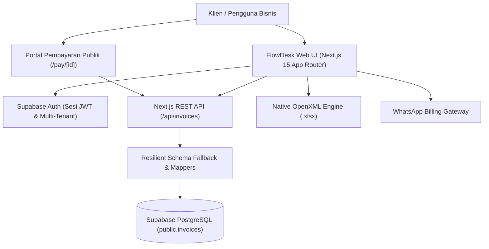

<div align="center">

# ⚡ FlowDesk — B2B Invoicing & Financial Operations Platform

**Production-grade B2B invoicing, client CRM, and shareable payment gateway engineered with Next.js 15, TypeScript, Tailwind CSS, and Supabase (PostgreSQL + Auth).**

[](https://nextjs.org/)
[](https://www.typescriptlang.org/)
[](https://supabase.com/)
[](https://tailwindcss.com/)
[](https://flowdesk.aads.my.id/)

[🌐 Buka Live Production](https://flowdesk.aads.my.id/) • [🔐 Portal Login](https://flowdesk.aads.my.id/login) • [📖 Repositori GitHub](https://github.com/mboa181-tech/project1-app)

</div>

---

## 🎯 Ringkasan Eksekutif (Overview)

**FlowDesk** adalah platform operasional penagihan dan keuangan B2B modern yang dirancang khusus untuk agensi, studio kreatif, dan bisnis jasa di Indonesia. FlowDesk menyatukan siklus penagihan faktur, pelacakan kepatuhan pembayaran klien (*Good Standing vs Overdue Balance*), ekspor laporan Excel native, pembagian faktur instan via WhatsApp, serta portal pembayaran mandiri (*self-service checkout*) dalam satu antarmuka *glassmorphic* yang responsif.

---

## ✨ Fitur Utama (Key Features)

### 1. 📊 Financial Command Center (`/`)
- **Pelacakan Keuangan Real-Time:** Menghitung total omset kotor, pendapatan lunas terverifikasi, piutang tertunda, tagihan jatuh tempo, dan tingkat penagihan (*collection rate*) dalam **Rupiah (IDR)**.
- **Siklus Hidup Faktur Lengkap:** Mengelola status `PAID` (Lunas), `PENDING` (Tertunda), `OVERDUE` (Jatuh Tempo), dan `DRAFT` (Draf) dengan satu klik.
- **Pencarian & Filter Cepat:** Temukan faktur berdasarkan nomor invoice, nama klien, email, atau status penagihan.
- **Bilingual & Tema:** Pengalih bahasa instan (**Bahasa Indonesia** & **English**) serta mode Gelap/Terang (*Dark/Light Mode*).

### 2. 🔐 Multi-Tenant Data Isolation (Isolasi Akun)
- **Partisi Data Mandiri:** Setiap akun yang login memiliki data faktur dan direktori klien yang terisolasi secara aman via `user_id` di database Supabase PostgreSQL.
- **Tanpa Kebocoran Data:** Data yang ditambahkan oleh Akun A hanya dapat diakses oleh Akun A dan tidak akan pernah bocor ke akun pengguna lain.

### 3. 📑 Ekspor Laporan Excel Native (.xlsx)
- **Zero-Dependency OpenXML Generator:** Mengompilasi format asli spreadsheet Microsoft Excel (`.xlsx`) langsung di memori browser.
- **Format Finansial Rapi:** Dilengkapi *header styling*, penyesuaian lebar kolom otomatis (*auto-fit*), dan format angka Rupiah (`Rp #,##0`) tanpa peringatan *format mismatch* atau *unsupported file type*.
- **Letak Terpusat:** Ditempatkan secara ergonomis dan eksklusif di header **Command Center** (Dashboard Utama).

### 4. 👥 Direktori Klien & CRM Nilai Kontrak (`/clients`)
- **Analisis Kepatuhan Pembayaran (Health Badge):**
  - 🟢 **Akun Sehat (*Good Standing*):** Klien tertib tanpa tagihan jatuh tempo.
  - 🔴 **Ada Piutang Jatuh Tempo (*Overdue Balance*):** Sinyal peringatan dini untuk klien yang melewati tenggat pembayaran.
- **Perhitungan Lifetime Value (LTV):** Melacak total akumulasi tagihan, dana diterima, dan piutang berjalan per korporasi.
- **Laci Riwayat Tagihan:** Pratinjau riwayat seluruh invoice klien beserta tautan langsung untuk penagihan baru.

### 5. 💳 Portal Pembayaran Klien Publik (`/pay/[id]`)
- **Tautan Mandiri Aman:** Halaman pembayaran yang dapat dibagikan langsung ke klien.
- **Multi-Metode Pembayaran:** Simulasi verifikasi instan via **QRIS**, **Virtual Account (BCA / Mandiri)**, dan **Kartu Kredit/Debit**.
- **Kwitansi Resmi Digital:** Mengunduh bukti pembayaran resmi bertanda verifikasi sistem.

### 6. 📱 Berbagi Faktur WhatsApp Instan
- **Format Pesan Rapi:** Menghasilkan template pesan penagihan dan bukti pelunasan otomatis dengan rincian invoice dan tautan pembayaran.
- **Pratinjau Link Profesional (OpenGraph):** WhatsApp menampilkan judul dan deskripsi resmi bisnis (*Faktur Tagihan Resmi #INV-xxxx — Portal Pembayaran Aman*), bersih tanpa istilah kode teknis.

### 7. 🏢 Pengaturan Profil Perusahaan & Jejak Audit
- **Identitas Bisnis Dinamis:** Mengatur nama PT/Workspace, NPWP, alamat kantor, rekening bank tujuan transfer, dan penandatangan faktur.
- **Audit Trail Logging:** Merekam setiap aksi pembuatan, perubahan status, pembaruan, dan penghapusan tagihan dengan pencatatan waktu WIB presisi.

---

## 🏗️ Arsitektur Sistem



---

## 🛠️ Tech Stack

| Lapisan | Teknologi | Penjelasan |
| :--- | :--- | :--- |
| **Framework** | Next.js 15 (App Router) | Server Components & Client Hydration berkecepatan tinggi |
| **Bahasa** | TypeScript 5.6 | Mode ketat (*Strict Mode*) untuk keandalan tipe data |
| **Desain & Gaya** | Tailwind CSS v3.4 | Antarmuka *Glassmorphism* modern dengan adaptasi tema |
| **Database & Auth** | Supabase (PostgreSQL + Auth) | Penyimpanan cloud permanen dengan Row Level Security |
| **Format Spreadsheet** | Native OpenXML `.xlsx` Engine | Generator berkas spreadsheet tanpa dependensi pihak ketiga |
| **Ikonografi** | Lucide React | Ikon antarmuka vektor yang ringan dan konsisten |
| **Hosting & CI/CD** | Vercel | Otomatisasi deploy terintegrasi dari cabang GitHub `main` |

---

## 📂 Struktur Repositori

```text
├── supabase/
│   └── schema.sql               # Skrip DDL PostgreSQL, indeks, RLS policy, & data awal
├── src/
│   ├── app/
│   │   ├── api/invoices/        # REST API endpoint (GET, POST, PUT, PATCH, DELETE)
│   │   ├── clients/             # Halaman Direktori Klien & CRM LTV
│   │   ├── login/               # Halaman Masuk & Pendaftaran Akun
│   │   ├── pay/[id]/            # Halaman Portal Pembayaran Mandiri Klien
│   │   │   ├── layout.tsx       # Metadata OpenGraph khusus pratinjau WhatsApp
│   │   │   └── page.tsx         # Antarmuka pembayaran QRIS / VA / Kartu
│   │   ├── globals.css          # Token desain Tailwind & efek Glassmorphism
│   │   ├── layout.tsx           # Layout root dengan metadata korporat & Context Providers
│   │   └── page.tsx             # Halaman Dashboard Finansial Utama
│   ├── components/
│   │   ├── ui/
│   │   │   └── glassy-dashboard.tsx # Komponen utama dashboard operasional
│   │   ├── AuditLogDrawer.tsx   # Laci riwayat audit operasional
│   │   ├── CompanySettingsModal.tsx # Modal pengaturan profil PT & nomor rekening
│   │   ├── InvoiceDetailModal.tsx   # Modal pratinjau & cetak faktur PDF
│   │   ├── InvoiceModal.tsx     # Form pembuat & pengubah faktur
│   │   ├── InvoiceTable.tsx     # Tabel daftar tagihan
│   │   └── StatsOverview.tsx    # Kartu ringkasan metrik
│   ├── context/
│   │   ├── AuthContext.tsx      # Manajemen sesi login Supabase Auth
│   │   ├── CompanyContext.tsx   # Pengaturan data profil perusahaan
│   │   └── LanguageContext.tsx  # Pengalih bahasa bilingual (ID / EN)
│   └── lib/
│       ├── format-currency.ts   # Formatter Rupiah & konversi terbilang
│       ├── i18n.ts              # Kamus terjemahan Bahasa Indonesia & Inggris
│       ├── mock-data.ts         # Data cadangan aman saat offline
│       ├── rate-limit.ts        # Pelindung lonjakan request (rate limiting)
│       ├── supabase.ts          # Klien Supabase & pemeta skema PostgreSQL
│       ├── types.ts             # Definisi interface TypeScript
│       ├── validation.ts        # Sanitasi data & pencegah XSS
│       └── whatsapp.ts          # Generator pesan penagihan & bukti pelunasan WA
├── .env.example                 # Contoh konfigurasi environment variables
├── package.json
└── tsconfig.json
```

---

## 🚀 Panduan Menjalankan Secara Lokal

### 1. Klon Repositori & Pasang Dependensi
```bash
git clone https://github.com/mboa181-tech/project1-app.git
cd project1-app
npm install
```

### 2. Konfigurasi Database Supabase
1. Buat proyek baru di [supabase.com](https://supabase.com).
2. Buka menu **SQL Editor**, lalu jalankan seluruh skrip yang ada di `supabase/schema.sql`.
   *(Jika tabel sudah pernah dibuat sebelumnya, pastikan kolom `user_id` sudah ada)*:
   ```sql
   ALTER TABLE public.invoices ADD COLUMN IF NOT EXISTS user_id text NOT NULL DEFAULT 'default_user';
   CREATE INDEX IF NOT EXISTS idx_invoices_user_id ON public.invoices(user_id);
   ```
3. Buka **Project Settings ➔ API**, salin `Project URL` dan `anon public key`.
4. Buat file `.env.local` di direktori utama:
   ```env
   NEXT_PUBLIC_SUPABASE_URL=https://proyek-anda.supabase.co
   NEXT_PUBLIC_SUPABASE_ANON_KEY=anon-key-anda
   ```

### 3. Jalankan Server Pengembangan
```bash
npm run dev
```
Buka browser Anda di [http://localhost:3000](http://localhost:3000).

---

## 🌐 Deploy ke Production (Vercel)

1. Hubungkan repositori GitHub Anda ke **Vercel**.
2. Pada bagian **Settings ➔ Environment Variables**, masukkan:
   * `NEXT_PUBLIC_SUPABASE_URL` = `https://<project-id>.supabase.co`
   * `NEXT_PUBLIC_SUPABASE_ANON_KEY` = `<anon-key>`
3. Klik **Deploy**. Setiap perubahan yang di-*push* ke cabang `main` akan diuji dan di-*deploy* otomatis.

---

## 📜 Lisensi & Pengembang

Dikembangkan dengan penuh dedikasi oleh **[@mboa181-tech](https://github.com/mboa181-tech)**.  
* Aplikasi Live: **[https://flowdesk.aads.my.id/](https://flowdesk.aads.my.id/)**
