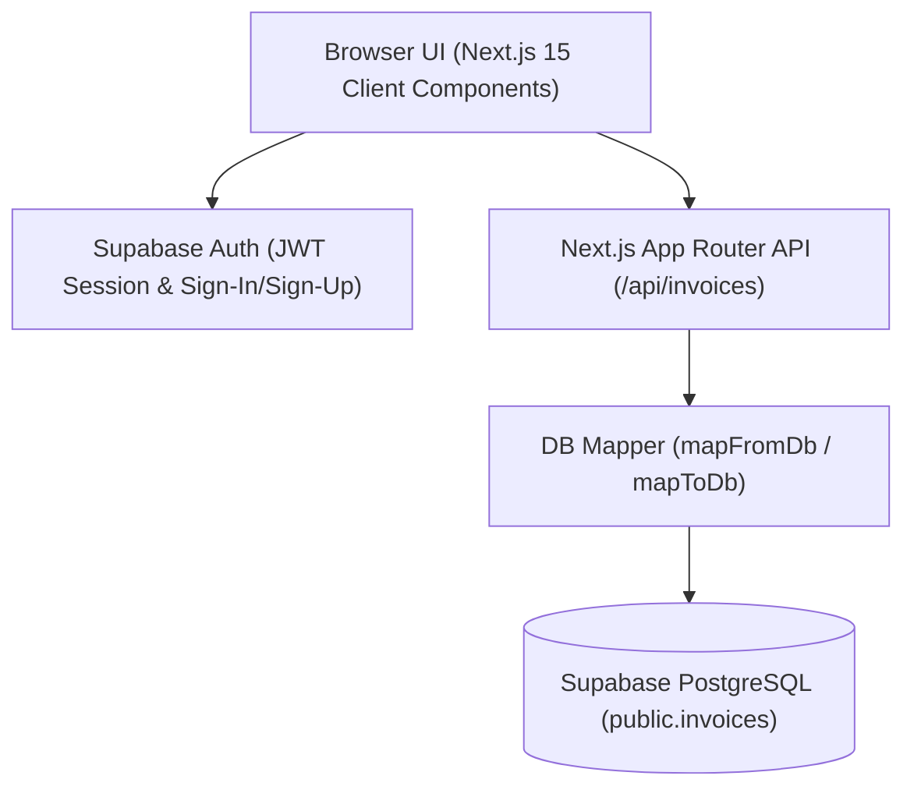

<div align="center">

# ⚡ FlowDesk — B2B Invoicing & Financial Operations Platform

**Full-stack B2B invoicing, client CRM, and payment portal engineered with Next.js 15, TypeScript, Tailwind CSS, and Supabase (PostgreSQL + Auth).**

[](https://nextjs.org/)
[](https://www.typescriptlang.org/)
[](https://supabase.com/)
[](https://tailwindcss.com/)
[](https://project1-app-khaki.vercel.app/)

[🌐 View Live Production Demo](https://project1-app-khaki.vercel.app/) • [🔐 Login Portal](https://project1-app-khaki.vercel.app/login) • [📖 GitHub Repository](https://github.com/mboa181-tech/project1-app)

</div>

---

## 🎯 Overview

**FlowDesk** is a modern B2B invoicing and financial operations web application built for agencies and service businesses in Indonesia. It unifies invoice management, client lifetime value (LTV) tracking, and a shareable client checkout portal in one responsive interface.

### Key Implemented Features
- **Real-Time Financial Dashboard (`/`)**: Tracks settled revenue, pending invoices, overdue receivables, and collection rate in **Indonesian Rupiah (IDR)**.
- **Full Invoice Lifecycle (`PAID`, `PENDING`, `OVERDUE`, `DRAFT`)**: Create invoices with dynamic line items and automatic tax (PPN 11%) calculation, toggle statuses, filter/search/sort, export CSV, and print/save PDF via a dedicated printable invoice modal.
- **Persistent Cloud Database (`Supabase PostgreSQL`)**: Backed by `/api/invoices` (`GET`, `POST`, `PATCH`, `DELETE`) connected to PostgreSQL with automatic schema mapping and graceful local fallback.
- **Supabase Authentication (`/login`)**: Real email/password sign-up and sign-in powered by Supabase Auth, session persistence in `AuthContext`, plus a Guest Preview mode for instant evaluation.
- **Client CRM Directory (`/clients`)**: Aggregates billed, settled, pending, and overdue balances per corporate account.
- **Public Client Payment Portal (`/pay/[id]`)**: Shareable invoice checkout page supporting Credit Card, Virtual Account (BCA/Mandiri), and QRIS payment flows with live status settlement.
- **Bilingual UI (Bahasa Indonesia & English) + Dark/Light Mode**: Instant language switcher (`ID` default / `EN`) persisted in `localStorage`.

---

## 🏗️ System Architecture



---

## 🛠️ Tech Stack

| Layer | Technology |
| :--- | :--- |
| **Framework** | Next.js 15 (App Router) & React 18 |
| **Language** | TypeScript (Strict Mode) |
| **Styling** | Tailwind CSS v3.4 & Lucide Icons |
| **Database & Auth** | Supabase (`@supabase/supabase-js` — PostgreSQL + Auth) |
| **Deployment** | Vercel (GitHub CI/CD Auto-Deploy) |

---

## 📂 Repository Structure

```text
├── supabase/
│   └── schema.sql               # PostgreSQL table DDL, indexes, RLS policy & IDR seed data
├── src/
│   ├── app/
│   │   ├── api/invoices/        # REST API handlers (GET, POST, PATCH, DELETE)
│   │   ├── clients/             # Client CRM & LTV directory page
│   │   ├── login/               # Supabase Auth sign-in & sign-up page
│   │   ├── pay/[id]/            # Public client payment gateway page
│   │   ├── globals.css          # Tailwind base styles & theme variables
│   │   ├── layout.tsx           # Root layout with LanguageProvider & AuthProvider
│   │   └── page.tsx             # Main financial dashboard
│   ├── components/
│   │   ├── InvoiceDetailModal.tsx
│   │   ├── InvoiceModal.tsx
│   │   ├── InvoiceTable.tsx
│   │   ├── Navbar.tsx
│   │   └── StatsOverview.tsx
│   ├── context/
│   │   ├── AuthContext.tsx      # Supabase Auth session state
│   │   └── LanguageContext.tsx  # Bilingual EN/ID state
│   └── lib/
│       ├── format-currency.ts   # Indonesian Rupiah (IDR) formatter
│       ├── i18n.ts              # EN & ID translation dictionary
│       ├── mock-data.ts         # Fallback seed data in IDR
│       ├── supabase.ts          # Safe Supabase client & DB mappers
│       └── types.ts             # TypeScript interfaces
├── package.json
└── tsconfig.json
```

---

## 🚀 Getting Started Locally

### 1. Clone & Install Dependencies
```bash
git clone https://github.com/mboa181-tech/project1-app.git
cd project1-app
npm install
```

### 2. Configure Supabase Database
1. Create a free project at [supabase.com](https://supabase.com).
2. Open **SQL Editor** and execute the script in `supabase/schema.sql`.
3. Create `.env.local` in the project root:
```env
NEXT_PUBLIC_SUPABASE_URL=https://your-project.supabase.co
NEXT_PUBLIC_SUPABASE_ANON_KEY=your-anon-or-publishable-key
```

### 3. Run Development Server
```bash
npm run dev
```
Open [http://localhost:3000](http://localhost:3000) in your browser.

---

## 📜 Author & Links

Built by **[@mboa181-tech](https://github.com/mboa181-tech)**  
* Live App: [https://project1-app-khaki.vercel.app/](https://project1-app-khaki.vercel.app/)
